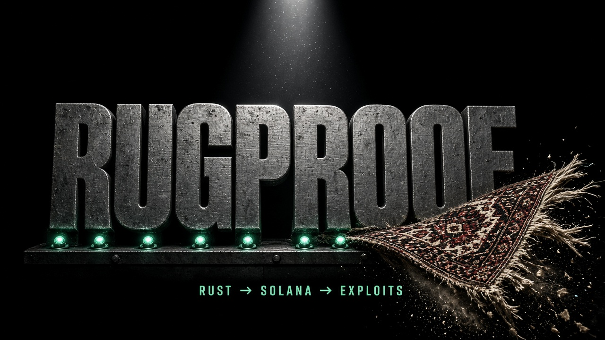
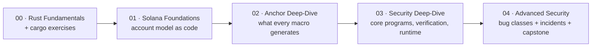

<p align="center">
  
</p>

<h1 align="center">Rugproof</h1>

<p align="center">
  <b>From Rust basics to code that can't be rugged.</b><br>
  A free, open Solana security path in five guides: Rust, the Solana account model, Anchor, auditing, and real-world exploits.
</p>

<p align="center">
  <a href="https://github.com/KhomDev/rugproof/actions/workflows/ci.yml"></a>
  <a href="./LICENSE"></a>
  <a href="./LICENSE-CONTENT"></a>
</p>

<p align="center">
  
</p>

---

Most Solana security material assumes you already read Rust fluently and already think in accounts, signers and PDAs. Rugproof doesn't. It starts with the Rust you actually need, shows every Solana concept as the code it really is, takes Anchor apart macro by macro, walks into the Agave runtime, and ends with the bug classes and real incidents behind most Solana losses.

One rule runs through all five guides: **if a check isn't written somewhere, it doesn't exist.** You learn to find where each check lives, or to prove that it's missing.

## The path



Each idea has **one home**. Later guides link back instead of teaching it again. 00 is Rust and Rust-level security. 01 is the account model as code, a native program, a first Anchor port, tokens, and the proof-of-check test pattern. 02 is Anchor. 03 is runtime invariants, the core programs, read-only verification (explorers and the CLI), CPI privilege flow, reading live protocols, and Agave. 04 is the bug-class catalogue, sourced incidents, the full audit checklist, and a capstone due-diligence report.

Every guide starts with a **Prerequisites / This file covers / This file does not cover** block and ends with previous/next links, so you can always see where you are.

| # | Guide | This file covers — you'll be able to… | Suggested time |
| --- | --- | --- | --- |
| 00 | [**Rust Fundamentals for Solana Developers**](./00-rust-fundamentals.md) | Read and write the Rust Solana code relies on: ownership, lifetimes, traits, `Result` + `thiserror`, iterators, `Rc<RefCell<…>>`, Borsh. Then the Rust security lens: overflow, panics as DoS, truncating casts, rounding, decoder bugs, SBF limits, `unsafe`, supply chain, security clippy lints, property tests and fuzzing. Graded Cargo exercises, plus spot-the-red-flag drills | 1–2 weeks |
| 01 | [**Solana Foundations: Rust and Solana Concepts in Code**](./01-solana-foundations.md) | See transactions, accounts and PDAs as structs (Rust itself stays in 00); write a native vault by hand; port it to Anchor; write your first proof-of-check test in LiteSVM; practise a first read-only look at official programs | 4–6 weeks with exercises |
| 02 | [**Anchor Framework Deep-Dive**](./02-anchor-deep-dive.md) | Read an Anchor program as the code it expands into: instruction lifecycle, every account type and constraint, CPIs, zero-copy, Token-2022, IDLs, 14 Anchor-specific bug patterns. [Eight exercises](./02-anchor-deep-dive.md#exercises), from a red-flag Accounts struct to a staking pool | 2–3 weeks |
| 03 | [**Solana Security Deep-Dive: From Account Model to Agave Runtime**](./03-solana-security-deep-dive.md) | Recite the runtime's account-model invariants; know what the core programs check and what they don't; verify upgrade authority, mint/freeze/fee/hook switches and LP holders with explorers and the CLI; trace privilege flow through CPIs; read an AMM, a lending market and a perp DEX; follow a transaction through Agave. [Eight exercises](./03-solana-security-deep-dive.md#exercises) | 8–12 weeks |
| 04 | [**Advanced Solana Security and Real-World Exploits**](./04-advanced-security-and-exploits.md) | Spot 16 bug classes with a short, annotated vulnerable snippet next to the fix; explain Wormhole, Cashio, Crema, Nirvana, Mango, Solend, Raydium, Slope and Loopscale in account-model terms (every figure sourced); run the full audit checklist; write a capstone due-diligence report | 2–4 weeks |

Already fluent in Rust? Skim 00 and do its Level 3–4 exercises. Already shipping Anchor programs? Start at 03, then 04.

## Who it's for

- **Developers moving from EVM to Solana** who want to think like an auditor
- **Bug-bounty hunters and auditors** who keep missing Solana findings because the account model doesn't feel native yet
- **Rust beginners** who want Solana as their first serious project
- **Solana developers** who want to stop shipping the bugs in guide 04

## Run the exercises

Every guide has a clearly headed **Exercises** section (eight graded items in 02–04; 00 and 01 have a longer levelled set). Hints and answers are in collapsible blocks. **Every guide also ships a runnable Cargo workspace** in [`exercises/`](./exercises/README.md): practice functions with a deep test suite (unit, property-based, adversarial, integration), plus a **capstone** where you spot the bug and then fix it.

| Guide | In the guide | Runnable workspace | Capstone (two planted bugs each) |
| --- | --- | --- | --- |
| 00 | [14. Exercises](./00-rust-fundamentals.md#exercises): fill in a real crate, spot red flags | [00-rust-fundamentals](./exercises/00-rust-fundamentals/README.md) | Points ledger: wrapping arithmetic, truncating cast |
| 01 | [Exercises](./01-solana-foundations.md#exercises): account model, official programs, native vault, Anchor port | [01-solana-foundations](./exercises/01-solana-foundations/README.md) | Treasury: missing signer check, missing owner check |
| 02 | [Exercises](./02-anchor-deep-dive.md#exercises): incomplete Accounts struct, staking pool | [02-anchor-deep-dive](./exercises/02-anchor-deep-dive/README.md) | Airdrop: non-canonical PDA bump, missing `has_one` |
| 03 | [Exercises](./03-solana-security-deep-dive.md#exercises): core-program invariants, explorer checks, pool audit | [03-solana-security-deep-dive](./exercises/03-solana-security-deep-dive/README.md) | Share vault: arbitrary CPI, substituted token account |
| 04 | [Exercises](./04-advanced-security-and-exploits.md#exercises): incident quiz, token checklist, due-diligence report | [04-advanced-security-and-exploits](./exercises/04-advanced-security-and-exploits/README.md) | Lending market: spot-price oracle, limit ignores existing debt |

The workspaces need only [Rust](https://rustup.rs) (stable). No validator, wallet or network:

```bash
git clone https://github.com/KhomDev/rugproof.git
cd rugproof/exercises/01-solana-foundations   # or any 0N-* folder

cargo test -p starter            # your work: fails until you replace the todo!()s
cargo test -p starter l1_        # one level at a time
cargo test -p solutions          # reference answers: all green
cargo test -p capstone           # exploit_* tests fail until you find and fix the bugs
cargo test -p capstone-solution  # the patched capstone: all green
```

The same tests run against `starter` and `solutions`, so a green `starter` means your answers hold up against the same attacks as the reference ones. In each capstone, every `exploit_*` test plays the attacker locally against a toy program, and CI checks that each one really fails on the flawed version.

Guides 01–04 also tell you what to install (Solana/Agave CLI, Anchor, LiteSVM) when a task needs the real toolchain. Vulnerable snippets are for detection: don't deploy them. Only run tests against programs you wrote, or against public educational repos the guide names.

## How to read the confidence tags

Guides 01–03 tag claims so you know how much to trust them:

- **[Certain]**: spec-level, or read directly in the source
- **[Likely]**: strong evidence, but may drift between versions
- **[Guessing]**: the author's inference; verify before relying on it

Solana moves fast. These guides track **Anchor 1.x** (with notes on 0.29–0.32), **Agave `master`** and the **p-token** Token program as of **November 2026**. Always check the version your target actually uses (`Cargo.lock`, feature gates) before writing a finding.

## Contributing

Found an error, a broken example, or something out of date? Issues and PRs are welcome. See [CONTRIBUTING.md](./CONTRIBUTING.md). Corrections with a source link (docs page, source line, SIMD, post-mortem) get merged fastest.

## License

- **Guide text** (the `.md` guides and images): [CC BY 4.0](./LICENSE-CONTENT). Share and adapt with attribution.
- **Code** (exercises, workflows and code snippets): [MIT](./LICENSE).

This split keeps the code freely reusable in any project while asking for credit when the writing is reused.

## Disclaimer

Rugproof is educational material. It is **not** an audit, not legal or financial advice, and no guarantee that code following it is secure. Vulnerable examples are deliberately broken: don't deploy them. Only test exploits against code you own or programs whose bug-bounty terms allow it. Incident write-ups summarize the cited public sources; where a source reports allegations (for example a regulator's complaint), the guide says so.

## Credits

Written by [KhomDev](https://khomdev.org), with AI assistance for research and drafting; every incident fact is checked against the linked source.

Built on the work of the Solana, Anza, Anchor and audit communities, especially [sealevel-attacks](https://github.com/coral-xyz/sealevel-attacks), the [Anchor docs](https://www.anchor-lang.com), the [Agave](https://github.com/anza-xyz/agave) source, and the security teams whose public post-mortems and analyses are cited in guide 04.
