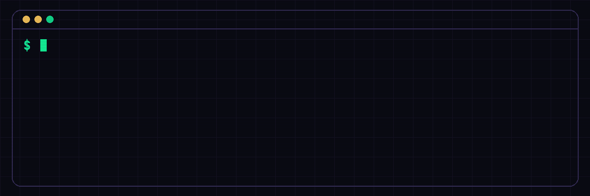
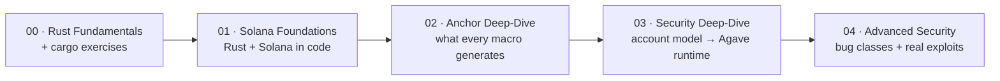

<p align="center">
  
</p>

<h1 align="center">Rugproof</h1>

<p align="center">
  <b>From Rust basics to code that can't be rugged.</b><br>
  A free, open Solana security path in five guides: Rust, the Solana account model, Anchor, auditing, and real-world exploits.
</p>

<p align="center">
  <a href="https://github.com/KhomDev/rugproof/actions/workflows/ci.yml"></a>
  <a href="./LICENSE"></a>
  <a href="./LICENSE-CONTENT"></a>
</p>

---

Most Solana security material assumes you already read Rust fluently and already think in accounts, signers and PDAs. Rugproof doesn't. It starts with the Rust you actually need, shows every Solana concept as the code it really is, takes Anchor apart macro by macro, walks into the Agave runtime, and ends with the bug classes and real incidents behind most Solana losses.

One rule runs through all five guides: **if a check isn't written somewhere, it doesn't exist.** You learn to find where each check lives, or to prove that it's missing.

## The path



| # | Guide | You'll be able to… | Suggested time |
| --- | --- | --- | --- |
| 00 | [**Rust Fundamentals for Solana Developers**](./00-rust-fundamentals.md) | Read and write the Rust Solana code relies on: ownership, lifetimes, traits, `Result` + `thiserror`, iterators, `Rc<RefCell<…>>`, integer pitfalls, Borsh. Graded exercises in a real Cargo workspace | 1–2 weeks |
| 01 | [**Solana Foundations: Rust and Solana Concepts in Code**](./01-solana-foundations.md) | See transactions, accounts and PDAs as structs; write a native vault by hand; port it to Anchor; write your first exploit test in LiteSVM | 4–6 weeks with exercises |
| 02 | [**Anchor Framework Deep-Dive**](./02-anchor-deep-dive.md) | Read an Anchor program as the code it expands into: instruction lifecycle, every account type and constraint, CPIs, zero-copy, Token-2022, IDLs, 14 Anchor-specific bug patterns | 2–3 weeks |
| 03 | [**Solana Security Deep-Dive: From Account Model to Agave Runtime**](./03-solana-security-deep-dive.md) | Audit for real: account-model invariants, core programs, privilege flow through CPIs, reading an AMM, a lending market and a perp DEX, and how Agave executes a transaction | 8–12 weeks |
| 04 | [**Advanced Solana Security and Real-World Exploits**](./04-advanced-security-and-exploits.md) | Spot 15 bug classes with vulnerable code next to the fix; explain Wormhole, Cashio, Crema, Nirvana, Mango, Solend, Raydium, Slope and Loopscale in account-model terms (every figure sourced); run a full audit checklist | 2–4 weeks |

Already fluent in Rust? Skim 00 and do its Level 3 exercises. Already shipping Anchor programs? Start at 03, then 04.

## Who it's for

- **Developers moving from EVM to Solana** who want to think like an auditor
- **Bug-bounty hunters and auditors** who keep missing Solana findings because the account model doesn't feel native yet
- **Rust beginners** who want Solana as their first serious project
- **Solana developers** who want to stop shipping the bugs in guide 04

## Run the exercises

Guide 00's exercises are a Cargo workspace. You need [Rust](https://rustup.rs) (stable).

```bash
git clone https://github.com/KhomDev/rugproof.git
cd rugproof/exercises/00-rust-fundamentals

cargo test -p starter        # your work: fails until you replace the todo!()s
cargo test -p starter l1_    # only Level 1
cargo test -p solutions      # reference answers: all green
```

The same unit, property-based and adversarial tests run against both crates, so a green `starter` means your answers hold up against the same attacks as the reference ones.

Guides 01–04 build Solana programs; they tell you what to install (Solana/Agave CLI, Anchor, LiteSVM) when you need it.

## How to read the confidence tags

Guides 01–03 tag claims so you know how much to trust them:

- **[Certain]**: spec-level, or read directly in the source
- **[Likely]**: strong evidence, but may drift between versions
- **[Guessing]**: the author's inference; verify before relying on it

Solana moves fast. These guides track **Anchor 1.x** (with notes on 0.29–0.32), **Agave `master`** and the **p-token** Token program as of **November 2026**. Always check the version your target actually uses (`Cargo.lock`, feature gates) before writing a finding.

## Contributing

Found an error, a broken example, or something out of date? Issues and PRs are welcome. See [CONTRIBUTING.md](./CONTRIBUTING.md). Corrections with a source link (docs page, source line, SIMD, post-mortem) get merged fastest.

## License

- **Guide text** (the `.md` guides and images): [CC BY 4.0](./LICENSE-CONTENT). Share and adapt with attribution.
- **Code** (exercises, workflows and code snippets): [MIT](./LICENSE).

This split keeps the code freely reusable in any project while asking for credit when the writing is reused.

## Disclaimer

Rugproof is educational material. It is **not** an audit, not legal or financial advice, and no guarantee that code following it is secure. Vulnerable examples are deliberately broken: don't deploy them. Only test exploits against code you own or programs whose bug-bounty terms allow it. Incident write-ups summarize the cited public sources; where a source reports allegations (for example a regulator's complaint), the guide says so.

## Credits

Written by [KhomDev](https://khomdev.org), with AI assistance for research and drafting; every incident fact is checked against the linked source.

Built on the work of the Solana, Anza, Anchor and audit communities, especially [sealevel-attacks](https://github.com/coral-xyz/sealevel-attacks), the [Anchor docs](https://www.anchor-lang.com), the [Agave](https://github.com/anza-xyz/agave) source, and the security teams whose public post-mortems and analyses are cited in guide 04.
